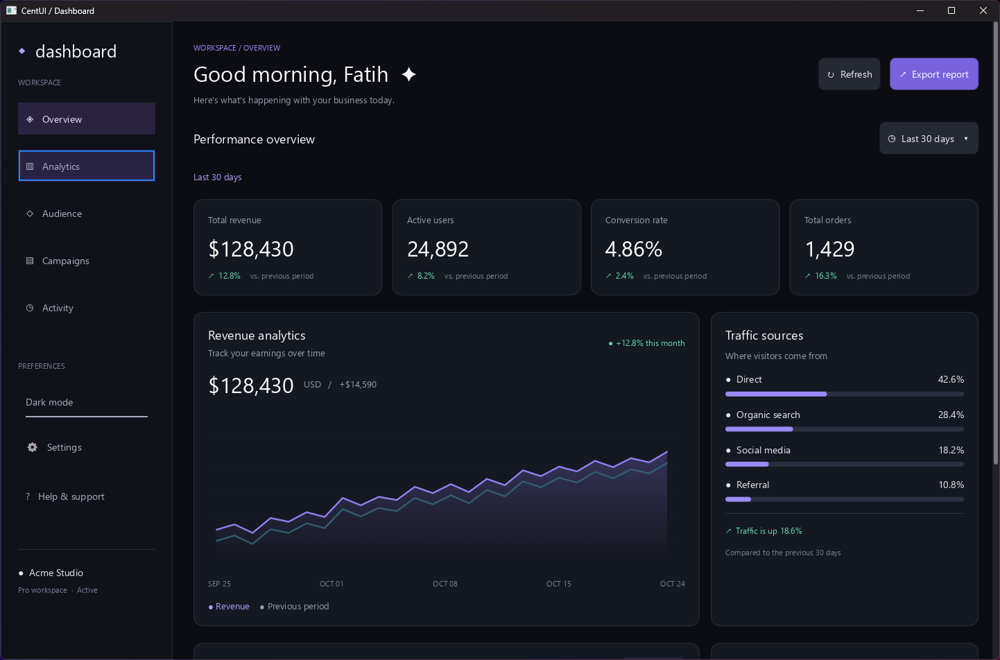

<h1 align="center">CentUI</h1>

<p align="center">Build C++ interfaces from widgets, styles, and ordinary application state.</p>

<p align="center">
  <a href="https://swordfatih.github.io/centui/">Documentation</a> ·
  <a href="docs/getting-started.md">Get started</a> ·
  <a href="docs/examples.md">Explore examples</a>
</p>

<p align="center">
  <a href="https://github.com/swordfatih/centui/actions/workflows/ci.yml"></a>
  
</p>

<p align="center">
  <a href="tests/examples/dashboard/main.cpp"></a>
</p>

CentUI is a C++20 UI library for tools, dashboards, and interfaces over an existing scene. Compose a widget tree once, describe its appearance with named C++ styles, and update it through callbacks. Your application owns the event loop.

## A small interface

Styles are ordinary structs. Handles let callbacks update the same widgets you put in the tree:

```cpp
struct action
{
    centui::edges padding = centui::edges::all(centui::px(12));
    float corner_radius = 8;
    centui::states_color background_color{
        .normal = {37, 99, 235, 255},
        .hover = {59, 130, 246, 255},
        .pressed = {29, 78, 216, 255},
    };
};

auto message = centui::text{"Hello, CentUI."};

auto root = centui::container{
    message,
    centui::button<action>{
        "Say hello",
        {
            .on_click = [message]
            {
                message->set_text("You clicked the button!");
            },
        }
    },
};
```

Put the tree in a `document`, connect a platform and renderer, and call `ui.frame(document)` from your loop. [Your first app](docs/getting-started.md) gives you the complete program and CMake setup.

## Try it

You need CMake 3.28+ and a C++20 compiler. From a checkout:

```sh
cmake -S . -B build -DCENTUI_BUILD_EXAMPLES=ON -DCENTUI_BUILD_SDL=ON -DCENTUI_BUILD_BGFX=ON
cmake --build build --target centui_example_getting_started
```

Run the executable under `build/tests/examples/getting_started/` (or its `Debug` subdirectory with a multi-configuration generator). [Build options](docs/build.md) covers platform dependencies and adding CentUI to your own project.

## Learn by building

| Start with | Build toward |
| --- | --- |
| [Your first app](docs/getting-started.md) | A window with a working counter. |
| [Widgets and styles](docs/widgets-and-styles.md) | Reusable components and flexible layouts. |
| [State and interaction](docs/interaction.md) | Inputs, dynamic lists, and dialogs. |
| [Text and fonts](docs/text.md) | Readable text and editable content. |
| [An existing application](docs/backends.md) | A UI over your own scene and event loop. |
| [Custom widgets](docs/extending.md) | Drawing and animation specific to your app. |

Prefer source code? Start with the [task list](tests/examples/task_list/main.cpp), [scene overlay](tests/examples/overlay/main.cpp), or [dashboard](tests/examples/dashboard/main.cpp). Each example teaches one application pattern. See the [example guide](docs/examples.md) for build targets.

Contributions are welcome. Read [CONTRIBUTING.md](CONTRIBUTING.md) for the code conventions.
